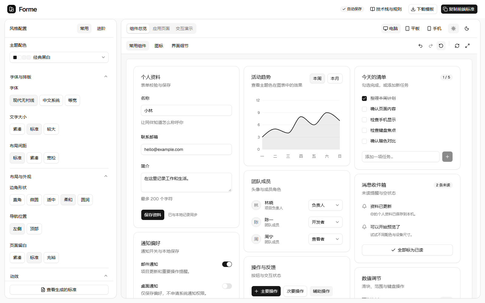

# Forme

面向中文用户的 shadcn/ui 选配工作台。使用开箱即用的官方组件与主题，通过中文预设调整外观和交互、实时查看效果，再将相同配置带入后续网页开发。

Forme 提供 24 套明暗配色、41 组预设，以及组件、业务页面和交互示例。选定配置后，可以复制完整前端标准，或下载包含相同组件源码、主题配置、开发规范和依赖锁文件的独立项目。



## 功能

| 能力 | 说明 |
| --- | --- |
| 配色与主题 | 24 套中性色与强调色配色；每套提供明暗模式，使用语义颜色变量 |
| 预设配置 | 外观、布局、图标、动效、交互、细节六类，共 41 组选项；常用区收纳高频设置 |
| 实时预览 | 电脑自适应、768px 平板、390px 手机；可直接输入、选择和操作 |
| 组件总览 | 默认 15 组组件组合，另有图标检索和界面细节示例 |
| 应用页面 | 项目列表、筛选、排序、分页、表单、通知设置和任务看板等本地示例 |
| 交互演示 | 动画、可调分栏、拖放、偏好保存，支持键盘与减少动态效果偏好 |
| 标准与模板 | 复制或保存完整前端标准，下载独立项目；浏览器与命令行共用生成器 |
| 本机保存 | 配置在浏览器自动保存，支持撤销、重做与恢复默认 |

## 快速开始

需要 **Node.js 24+** 和 **pnpm 11.25.0**。直接依赖固定精确版本，使用 lockfile 安装。

```sh
git clone https://github.com/haoch1/forme.git
cd forme
pnpm install --frozen-lockfile
pnpm dev
```

开发地址为 `http://127.0.0.1:5173`，默认仅监听本机地址。

```sh
pnpm package:template
pnpm build
pnpm preview
```

生产预览地址为 `http://127.0.0.1:4173`。构建前执行 `package:template`，使下载按钮提供与当前源码一致的模板 ZIP。

## 使用流程

1. 在“常用”选择配色、字体、字号、布局间距和圆角。
2. 在“进阶”调整布局、图标、动效与交互细节。修改细节项后，右侧展示对应的组件示例。
3. 切换组件总览、应用页面或交互演示，在不同设备宽度下验证真实操作。
4. 使用“复制前端标准”将规范交给开发者或编码助手，或使用“下载模板”开始独立项目。

工作台外壳保持固定字体和间距，项目预设应用于预览与导出内容。桌面两侧独立滚动，配置切换沿用已挂载的预览文档。字号、布局间距、图标和控件高度分别控制，避免互相缩放。

## 预设范围

| 分类 | 数量 | 可调整内容 |
| --- | ---: | --- |
| 外观 | 7 | 主题配色、明暗模式、字体、文字大小、布局间距、边角形状、页面底色 |
| 布局 | 4 | 导航位置、侧栏宽度、内容宽度、页面留白 |
| 图标 | 2 | 图标大小、图标线条 |
| 动效 | 4 | 动态效果、出现方式、动画速度、运动节奏 |
| 交互 | 7 | 分栏方向、初始比例、尺寸记忆、任务拖动方式、拖放提示、任务顺序保存、应用偏好保存 |
| 细节 | 17 | 原生选项组、页签和按钮变体、按钮尺寸、必填与校验、文案、切换与加载、错误位置、消息、空状态、弹窗关闭与提示 |

细节项沿用成熟组件的原生交互语义。消息设置传给 Sonner，表单校验时机传给 React Hook Form，弹窗与提示的交互交给 Radix。预设适配与原生变体的边界见 [组件规范](docs/component-policy.md)。

### 默认设置

采用官方称为经典外观的 **Vega**，搭配 **Neutral** 配色和 **Geist** 字体。组件有对应 shadcn 实现时直接复用；默认不再覆盖它的字重、焦点、选中态和卡片轮廓。来源与对应值见 [默认风格](docs/default-profile.md)。

默认值统一维护在 [`default-config.json`](src/design-system/default-config.json)。首次进入、旧配置补齐、恢复默认和模板生成共用这一基线；旧版未改动的默认值一次迁移到这一基线，其他已保存的有效选择优先保留。

| 设置 | 默认值 |
| --- | --- |
| 主题 | Vega / Neutral / Geist，浅色 |
| 根字号 / 圆角 | 16px / 0.625rem |
| 布局间距 | 标准 16px，仅调整容器 gap |
| Card / FieldGroup | 原生 24px 内边距、shadow-xs、ring / 原生 28px 分组 |
| Button / ToggleGroup / Tabs | default 原生变体，Button 标准 36px |
| 焦点、字重、悬停、禁用 | 各组件原生状态，不另写覆盖 |
| Dialog / Tooltip / Sonner | 原生弹窗 / 0ms 提示 / 右下 4 秒且无关闭按钮 |
| 内容切换 | 直接切换，已加载内容不重载 |

保留 41 组实际可调整项，取消原来手写的控件状态外观选项。左侧不堆叠实现说明，调整后通过真实组件预览确认效果。所有默认值统一设置，后续可以手动修改。

## 复制标准与独立模板

复制的标准包含完整开发规则、41 项实际选择、精确技术栈、实现映射和可复现 JSON。下载 ZIP 同时包含：

| 文件 | 用途 |
| --- | --- |
| `前端标准.md` | 实际选择对应的完整开发标准 |
| `AGENTS.md` | 后续页面与组件开发规则 |
| `src/selected-theme.json` | 可复现配置 |
| `src/selected-theme.css` | 当前配置生成的语义主题变量 |
| `src/components/` | 与预览共用的基础组件及原生参数适配器 |
| `docs/`、`third-party/` | 架构、组件边界、来源与第三方许可证 |
| `package.json`、`pnpm-lock.yaml` | 精确依赖与可复现安装信息 |

命令行创建独立项目：

```sh
# 使用统一默认设置
pnpm template ../my-app

# 使用导出的主题 JSON
pnpm template ../my-themed-app ./style-theme.json
```

脚本拒绝覆盖已有目录。进入生成目录后执行 `pnpm install --frozen-lockfile`、`pnpm dev`，默认地址为 `http://127.0.0.1:5174`。独立项目采用 Hash 路由，可部署到静态托管服务。

**导出的实际选择成为后续页面与组件的默认配置。** 缺少的字段才从统一基线补齐；后续明确修改的部分按新要求执行，其余部分持续继承。业务名称、文案、数据和路由由需求决定，演示内容不限制业务领域。

规则统一来自 [`generation-rules.md`](src/design-system/generation-rules.md)。复制标准、规则弹窗、浏览器模板和命令行模板共用该规则源。业务布局按项目需求组织，不强制采用工作台配置栏。

## 技术栈与组件边界

| 职责 | 实现 |
| --- | --- |
| 应用与构建 | React、TypeScript、Vite、pnpm |
| UI 与样式 | shadcn/ui radix-vega、Radix UI、Tailwind CSS |
| 图标 / 动画 | Lucide / Motion |
| 路由 / 异步缓存 | TanStack Router / TanStack Query |
| 表格 / 表单 | TanStack Table / React Hook Form + Zod |
| 图表 / 通知 | Recharts + shadcn Chart / Sonner |
| 分栏 / 拖放 | react-resizable-panels / dnd-kit |
| 客户端状态 | Zustand |

每类职责采用一套固定实现。精确版本见 [`package.json`](package.json)、[`stack-policy.json`](stack-policy.json) 和 lockfile。

`src/components/ui` 保留 shadcn 原生结构、接口和变体；`configured-components.tsx` 只将预设映射到原生参数，不再维护单独的控件外观覆盖层。32 个基础组件均记录 registry 来源与源码摘要，必要的小范围补丁逐项说明。`check:ui` 是项目的源码一致性检查，不代表官方认证。

## 工程结构

```text
src/
  components/ui/          shadcn 基础组件
  components/             原生参数适配器及共享组合
  design-system/          色板、选项目录、默认值、规则和标准生成器
  features/guide/         配置工作台与同源预览入口
  features/examples/      组件组合、业务页面和细节示例
  features/interactions/  拖放交互
  stores/                 设计配置状态
template/                 独立项目入口及专用文档
scripts/                  检查、标准生成与模板打包
deploy/                   通用容器及反向代理配置
third-party/              来源、源码摘要与第三方许可证
```

进一步阅读：[设计系统](docs/design-system.md)、[工程架构](docs/architecture.md)、[组件规范](docs/component-policy.md)、[与编码助手协作](docs/ai-project-brief.md)。

## 验证与维护

```sh
pnpm typecheck
pnpm lint
pnpm check:stack
pnpm check:ui
pnpm check:defaults
pnpm check:template
pnpm package:template
pnpm build
```

代码检查之外，还需验证真实交互、桌面与移动布局、预设组合，以及复制标准和下载模板是否一致。字号和密度变更尤其需要检查图标卡片、开关滑块、图表及布局断点。

新增或更新基础组件前，先用 shadcn CLI 查看差异，保留必要补丁并更新来源记录。避免通过全局固定高度、全局状态选择器或 `transition-all` 改写全部组件。

## Docker 与 GitHub Actions

推送 `main` 或手动触发后，GitHub Actions 安装锁定依赖、执行检查、生成模板、构建网页并发布 Nginx 静态镜像。Actions 固定提交版本，镜像同时保留 `latest` 和完整提交号标签，并记录不可变 digest。

部署时使用 `deploy/compose.yaml`，将 `FORME_IMAGE` 指向发布的镜像 digest。名称统一为 `forme`：仓库、镜像、Compose 项目、服务和容器。容器监听 8080，默认映射到主机 `127.0.0.1:4183`；HTTPS 由外部反向代理处理。健康检查地址为 `/healthz`，应用路由使用 SPA fallback。

真实域名、服务器连接信息与认证文件仅保留在部署环境。仓库中的 `example.com` 是占位示例，文档、截图和构建日志不得记录私人部署信息。完整说明见 [部署文档](docs/deployment.md)。

## 数据与隐私

当前项目是前端应用，没有账号、数据库或业务 API。设计配置与演示数据保存在浏览器本地，不同域名的存储独立；清理站点数据会删除对应记录。下载模板包含开发配置和示例源码，不打包浏览器中的业务记录。

## 来源与许可

UI 基础来自 [shadcn/ui](https://ui.shadcn.com)，工作台组织参考 [shadcn Create](https://ui.shadcn.com/create)，配色及部分结构参考 tweakcn、shadcn-admin；早期暗色分层研究参考 Radix Colors。固定版本、上游提交、使用范围和许可证见 [`third-party/`](third-party/)；引用与修改第三方代码时保留其许可和来源。
